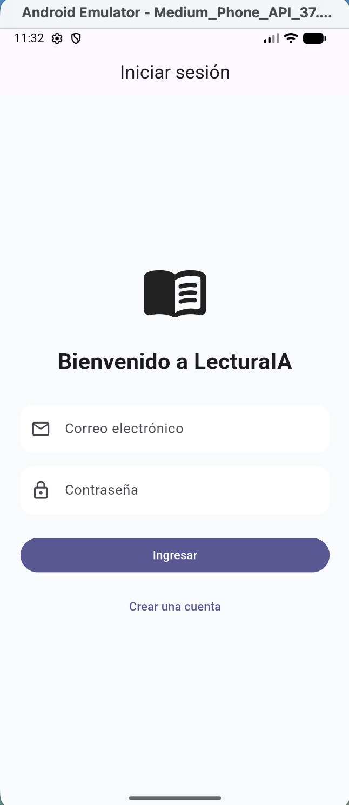
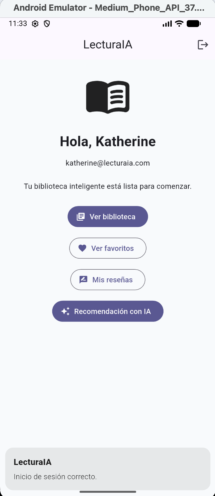
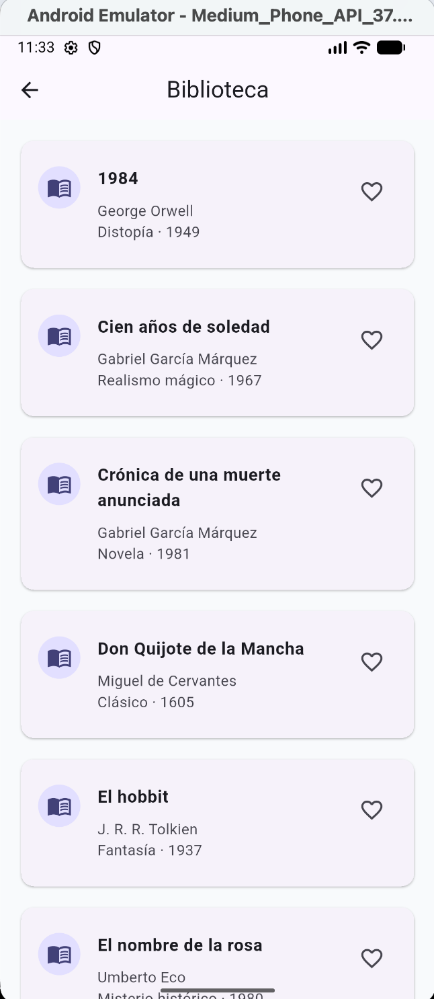
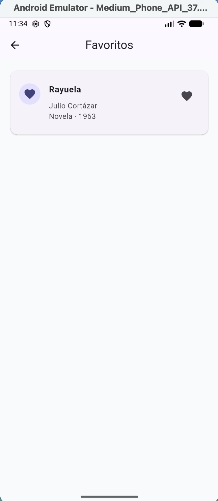
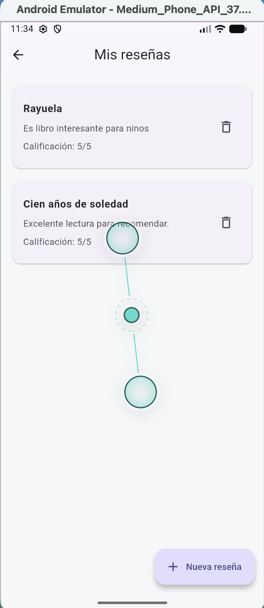
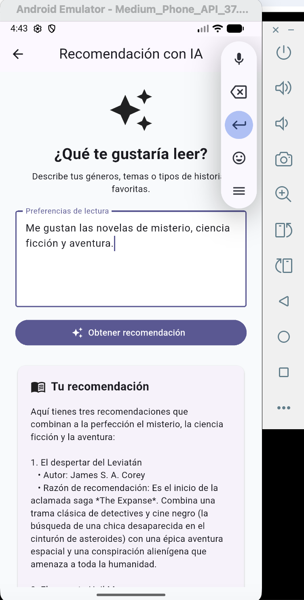

# LecturaIA

LecturaIA es una aplicación móvil desarrollada con Flutter para gestionar una biblioteca personal inteligente. Permite consultar un catálogo de libros, guardar favoritos de forma local, crear reseñas asociadas a usuarios autenticados y obtener recomendaciones de lectura mediante inteligencia artificial.

El proyecto fue desarrollado como Proyecto Final del curso **Desarrolla Aplicaciones Móviles Robustas con Flutter e IA**, utilizando Flutter, GetX y un backend propio construido con FastAPI.

---

## Funcionalidades principales

- Registro de usuarios.
- Inicio y cierre de sesión.
- Autenticación mediante JWT.
- Almacenamiento seguro del token de sesión.
- Catálogo propio de 20 libros servido desde el backend.
- Estados de carga, contenido vacío y error.
- Libros favoritos con persistencia local mediante Hive.
- Creación, consulta y eliminación de reseñas.
- Reseñas protegidas mediante autenticación.
- Recomendaciones personalizadas de libros mediante Gemini.
- Manejo de errores de conexión y respuestas HTTP.
- Gestión centralizada del estado mediante GetX.
- CI automático con GitHub Actions.
- Generación automática del APK mediante GitHub Releases.

---

## Tecnologías utilizadas

### Aplicación móvil

- Flutter
- Dart
- GetX
- Dio
- Hive
- Hive Flutter
- Flutter Secure Storage

### Backend

- Python
- FastAPI
- SQLAlchemy
- SQLite
- JWT
- Passlib
- bcrypt
- HTTPX
- python-dotenv

### Inteligencia artificial

- Gemini API.
- La clave del proveedor se almacena únicamente en el backend.
- Flutter nunca contiene ni envía directamente la clave de Gemini.

---

## Arquitectura

La aplicación utiliza una arquitectura por capas.

```text
Flutter
│
├── Screens
│     │
│     ▼
├── GetX Controllers
│     │
│     ▼
├── Services
│     │
│     ▼
└── FastAPI Backend
      │
      ├── SQLite
      ├── JWT
      ├── Dataset de libros
      └── Gemini API

## Capturas de pantalla

Las siguientes capturas muestran las principales funcionalidades de LecturaIA.

### Inicio de sesión



### Pantalla principal



### Biblioteca



### Favoritos



### Reseñas



### Recomendación con IA


